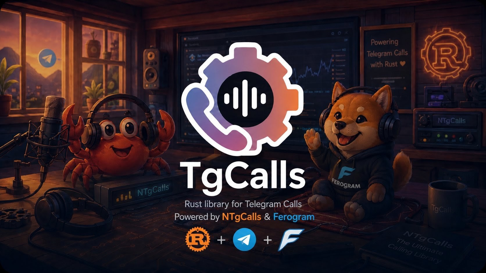
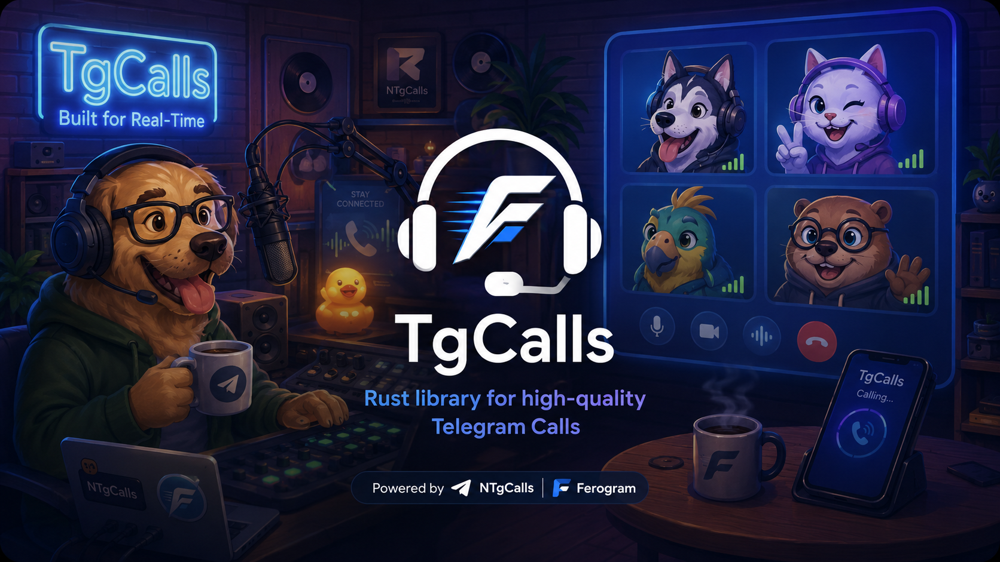

<p align="center">
    <b>An elegant Rust library for Telegram voice and video calls.</b>
    <br>
    <sub>Powered by <a href="https://github.com/pytgcalls/ntgcalls">ntgcalls</a> and <a href="https://github.com/ankit-chaubey/ferogram">ferogram</a>.</sub>
    <br><br>
    <a href="https://github.com/ankit-chaubey/tgcalls/tree/main/examples">
        Examples
    </a>
    •
    <a href="https://docs.rs/tgcalls">
        Documentation
    </a>
    •
    <a href="https://crates.io/crates/tgcalls">
        Crates.io
    </a>
    •
    <a href="https://github.com/ankit-chaubey/ferogram">
        Ferogram
    </a>
</p>

# TgCalls [](https://crates.io/crates/tgcalls) [](https://crates.io/crates/tgcalls)

**TgCalls** brings voice and video calling to Telegram clients written in Rust. It bridges Telegram's calling stack with a clean Rust API, making it easy to stream media, join voice chats, and integrate voice and video calling into your Telegram clients.

Whether you're building a music bot, a voice assistant, or any application that needs to participate in Telegram calls, TgCalls gets you there with a simple and ergonomic API.

## Getting Started

Add `tgcalls` to your `Cargo.toml`:

```toml
[dependencies]
tgcalls = "=0.4.0-alpha1"
```

Before using `tgcalls`, make sure you have:

- **FFmpeg** available on your `PATH` for media decoding.

On Debian/Ubuntu:

```bash
sudo apt install ffmpeg
```

## Examples

To try the examples:

```bash
git clone https://github.com/ankit-chaubey/tgcalls.git
cd tgcalls

export API_ID=123456
export API_HASH=your_api_hash_here

cargo run --example group_audio_call -- -1001234567890 /path/to/song.mp3
```

On the first run, you'll be asked to sign in with your phone number and login code. Your session is then saved locally, so you only need to authenticate once.

<p align="center">
    
</p>

## Let's Stream

Joining a group call and playing a file takes just a few lines:

```rust
let calls = Calls::new(client);
calls.play(chat_id, "song.mp3").await?;
```

Behind the scenes, **TgCalls** handles everything required to get your media into the call. It creates or joins the group call, establishes the media connection, negotiates with Telegram, and streams your audio or video through FFmpeg. All you need to provide is the client, the chat, and the media you want to play.

To leave the call:

```rust
calls.leave(chat_id).await?;
```

Let's go through the [examples](https://github.com/ankit-chaubey/tgcalls/tree/main/examples) to see it in action:

```bash
cargo run --example group_audio_call -- -1001234567890 /path/to/song.mp3
```

Direct, one-on-one calls work the same way in spirit, ring someone, exchange keys, stream, though the setup underneath is a little more involved since P2P calls are end-to-end encrypted and need a live signaling loop while connecting. The `p2p_audio_call` example walks through it end to end.

Video and screen share follow the same pattern, `Media::video`, `Media::av`, and `Media::screen` build the right ffmpeg pipeline for you. The `examples/` folder has a short, working file for each of these, that's genuinely the fastest way to see how it all fits together.

## Controls

Every call type (group, private, conference) has the same controls, with the same names, and you can use them at any time while the call is up:

```rust
calls.mute(chat_id).await?;                                  // mic off
calls.unmute(chat_id).await?;                                // mic on
calls.pause(chat_id).await?;                                 // pause the stream
calls.resume(chat_id).await?;
calls.set_video(chat_id, Some(video)).await?;                // video on, or swap it
calls.set_video(chat_id, None).await?;                       // video off
calls.set_audio(chat_id, Some(audio)).await?;                // audio source on, or swap it
calls.set_audio(chat_id, None).await?;                       // remove the audio source
calls.set_screen(chat_id, Some(Media::screen(1280, 720, 30))).await?;  // share screen
calls.set_screen(chat_id, None).await?;                      // stop sharing
calls.set_sources(chat_id, StreamMode::Capture, &media).await?;        // replace everything at once
let state = calls.media_state(chat_id).await?;               // muted, video paused, ...
```

These are the operations ntgcalls itself has, one name each:

| Slot | What it is | Method |
|---|---|---|
| Microphone | the audio you send (a file, a device or raw frames) | `set_audio` |
| Camera | the video you send | `set_video` |
| Screen | a second, separate video track, can run alongside the camera | `set_screen` |
| Speaker | where incoming audio goes, for recording | `set_sources(StreamMode::Playback, ..)` |

`mute` silences the mic and keeps its source; `set_audio(None)` removes the source. `pause` stops the whole outgoing stream.

Changing one slot keeps the others, and your state is pushed to Telegram automatically, so other participants see it. `Call`, `P2PCall` and `ConferenceCall` use the same method names without the `chat_id`, and all three implement the `CallControls` trait, so a function written against `impl CallControls` works with any of them. Raw frames in and out (`send_external_frame`, `on_frames`), remote video (`add_incoming_video`, `remove_incoming_video`) and info (`played_seconds`, `call_type`, `connection_mode`, `cpu_usage`) are on every call type too. `examples/call_controls.rs` drives the controls from the terminal.

## Credits

TgCalls wouldn't exist without these projects and the people behind them.

* <b><a href="https://github.com/ankit-chaubey">@ankit-chaubey</a>
    * Creator of [TgCalls](https://github.com/ankit-chaubey/tgcalls) and [Ferogram](https://github.com/ankit-chaubey/ferogram)

* <b><a href="https://github.com/Laky-64">@Laky-64</a>
    * Creator of [NTgCalls](https://github.com/pytgcalls/ntgcalls)

## License

Licensed under either the [MIT License](https://github.com/ankit-chaubey/tgcalls/blob/main/LICENSE-MIT) or the [Apache License 2.0](https://github.com/ankit-chaubey/tgcalls/blob/main/LICENSE-APACHE), at your option.
